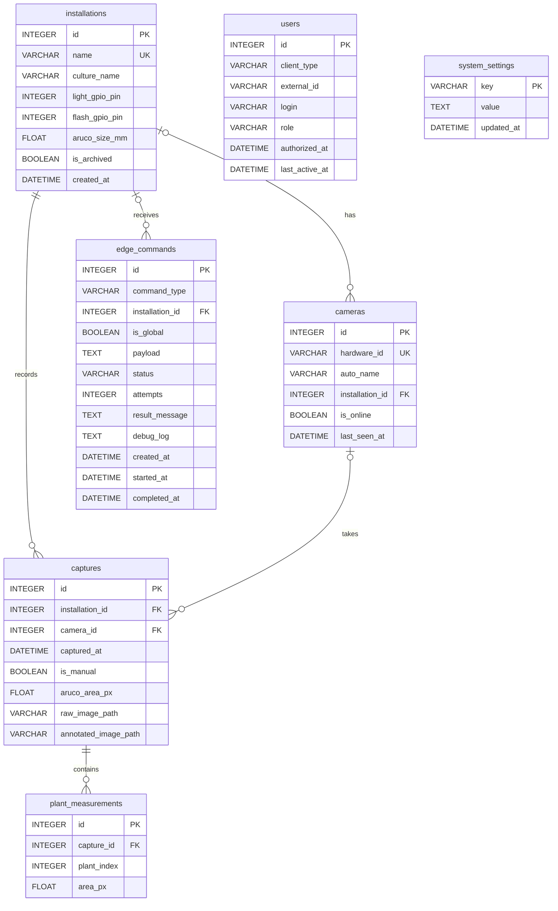

# GrowVision — Схема базы данных (MVP)

Документ полностью описывает реляционную модель данных GrowVision: таблицы, поля, связи, ограничения, индексы и бизнес-правила.

**СУБД:** SQLite (MVP). **ORM:** SQLAlchemy. Типы данных выбраны универсальными, чтобы при необходимости перейти на PostgreSQL без переработки схемы.

## Что покрывает схема

- Произвольное число установок и несколько камер на одной установке.
- История снимков (плановых и ручных), привязанная к установке: при замене камеры таймлапс не рвётся.
- Площадь растения в px или см² (по ArUco-маркеру), с заделом под несколько кустов на одном кадре.
- Ролевая модель (Гость / Биолог / Разработчик) с учётом логина и времени активности.
- Очередь команд Сервер → Raspberry Pi (pull-модель, работает за школьным NAT без проброса портов).
- Глобальные настройки и последняя телеметрия RPi.

---

## 1. ER-диаграмма



Таблицы `users` и `system_settings` с остальными связями не соединены: первая хранит сессии, вторая — настройки.

## 2. Связи между таблицами

| Родитель | Потомок | Поле (FK) | Кардинальность | ON DELETE | Смысл |
|---|---|---|---|---|---|
| installations | cameras | `cameras.installation_id` | 0..1 → 0..N | SET NULL | Камера может быть свободной; у установки 0, 1 или несколько камер. |
| installations | captures | `captures.installation_id` | 1 → 0..N | RESTRICT | История установки не удаляется вместе с ней; штатный путь — архивация. |
| cameras | captures | `captures.camera_id` | 0..1 → 0..N | SET NULL | Хранит, какой камерой сделан кадр; при удалении камеры кадры остаются. |
| captures | plant_measurements | `plant_measurements.capture_id` | 1 → 0..N | CASCADE | Замеры бессмысленны без снимка; у кадра их может не быть (растение не обнаружено). |
| installations | edge_commands | `edge_commands.installation_id` | 0..1 → 0..N | CASCADE | Команда на конкретную установку; глобальные команды без установки. |

---

## 3. Описание таблиц

### 3.1. `installations` — Гидропонные установки

Хранит конфигурацию каждой установки. При завершении выращивания установка не удаляется, а переводится в архив (`is_archived = TRUE`): история таймлапса сохраняется, а GPIO-пины и камеры освобождаются для новых установок.

| Поле | Тип | Ограничения | Описание |
|---|---|---|---|
| id | INTEGER | PK, AUTOINCREMENT | Уникальный ID установки. |
| name | VARCHAR(100) | UNIQUE, NOT NULL | Уникальное название (напр. «Установка 1 — Фитолампа»). Используется в CLI и боте. |
| culture_name | VARCHAR(100) | NOT NULL | Выращиваемая культура (напр. «Салат Афицион»). |
| light_gpio_pin | INTEGER | NOT NULL | Пин BCM на RPi для реле основного света. |
| flash_gpio_pin | INTEGER | NOT NULL | Пин BCM на RPi для реле вспышки. |
| aruco_size_mm | FLOAT | NULLABLE, CHECK (> 0) | Реальная длина стороны ArUco-маркера в мм. Если NULL — площадь выводится только в px. |
| is_archived | BOOLEAN | NOT NULL, DEFAULT FALSE | Флаг архивации. Архивные установки не снимаются по таймеру, но доступны для просмотра в вебе. |
| created_at | DATETIME | NOT NULL, DEFAULT CURRENT_TIMESTAMP | Время создания (UTC). |

Уникальность пинов задаётся не в колонках, а частичными индексами только среди активных установок (см. раздел 4).

### 3.2. `cameras` — Физические камеры на Raspberry Pi

Связь «много камер → одна установка». Камера может быть ни к чему не привязана.

| Поле | Тип | Ограничения | Описание |
|---|---|---|---|
| id | INTEGER | PK, AUTOINCREMENT | Внутренний ID камеры. |
| hardware_id | VARCHAR(255) | UNIQUE, NOT NULL | Постоянный идентификатор Linux из `/dev/v4l/by-id/` (не меняется при перезагрузке RPi). |
| auto_name | VARCHAR(150) | NOT NULL | Читаемое имя модели, получаемое автоматически через `v4l2-ctl`. |
| installation_id | INTEGER | FK → installations.id (SET NULL), NULLABLE | Установка, к которой привязана камера; NULL — камера свободна. |
| is_online | BOOLEAN | NOT NULL, DEFAULT FALSE | Доступность по данным последнего heartbeat или сканирования. |
| last_seen_at | DATETIME | NULLABLE | Когда RPi последний раз видела камеру подключённой (UTC). |

### 3.3. `captures` — Снимки (кадры)

Кадр привязан к `installation_id`, поэтому история таймлапса не зависит от замены камеры. `camera_id` сохраняет информацию, какой камерой сделан конкретный кадр.

| Поле | Тип | Ограничения | Описание |
|---|---|---|---|
| id | INTEGER | PK, AUTOINCREMENT | Уникальный ID снимка. |
| installation_id | INTEGER | FK → installations.id (RESTRICT), NOT NULL | Установка, к которой относится кадр. |
| camera_id | INTEGER | FK → cameras.id (SET NULL), NULLABLE | Камера, сделавшая снимок. |
| captured_at | DATETIME | NOT NULL | Точное время съёмки на RPi (UTC), нормализуется сервером до секунд (`YYYY-MM-DDTHH:MM:SSZ`) перед проверкой уникальности. Важно для правильного порядка при выгрузке из офлайн-очереди. |
| is_manual | BOOLEAN | NOT NULL, DEFAULT FALSE | FALSE — плановый кадр по таймеру (идёт в таймлапс); TRUE — внеочередной ручной снимок (в таймлапс не попадает). |
| aruco_area_px | FLOAT | NULLABLE, CHECK (> 0) | Площадь найденного на кадре ArUco-маркера в px; NULL, если маркер не найден. Хранится на уровне кадра, так как маркер один на кадр. |
| raw_image_path | VARCHAR(255) | NOT NULL | Относительный путь к исходному фото на сервере (в вебе показывается по умолчанию). |
| annotated_image_path | VARCHAR(255) | NOT NULL | Относительный путь к фото с наложенной разметкой нейросети (приходит готовым с RPi). |

### 3.4. `plant_measurements` — Замеры площади растений

Вынесена в отдельную таблицу (1 снимок → N растений). В MVP на кадр приходится не более одной записи (`plant_index = 0`); если растение не обнаружено, записей нет. Переход на несколько кустов не требует миграции схемы.

| Поле | Тип | Ограничения | Описание |
|---|---|---|---|
| id | INTEGER | PK, AUTOINCREMENT | Уникальный ID замера. |
| capture_id | INTEGER | FK → captures.id (CASCADE), NOT NULL | Ссылка на снимок. |
| plant_index | INTEGER | NOT NULL, DEFAULT 0 | Порядковый номер куста на кадре (0 для MVP). |
| area_px | FLOAT | NOT NULL, CHECK (>= 0) | Площадь маски растения в px. |

### 3.5. `users` — Авторизованные сессии (Telegram-бот и CLI)

Хранит активные сессии после двухэтапной авторизации (логин → пароль). При выходе запись удаляется. Роль «Гость» отдельной записью не хранится: это неавторизованный клиент, которому в таблице соответствует отсутствие записи.

| Поле | Тип | Ограничения | Описание |
|---|---|---|---|
| id | INTEGER | PK, AUTOINCREMENT | Уникальный ID записи. |
| client_type | VARCHAR(20) | NOT NULL, CHECK (IN ('telegram', 'cli')) | Тип клиента. |
| external_id | VARCHAR(100) | NOT NULL | `telegram_id` для бота или идентификатор профиля CLI (`cli_<uuid4>`). |
| login | VARCHAR(100) | NOT NULL | Логин (имя), введённый пользователем (напр. «Иван Иванов»). |
| role | VARCHAR(20) | NOT NULL, CHECK (IN ('biologist', 'developer')) | Роль, определённая по введённому паролю. |
| authorized_at | DATETIME | NOT NULL, DEFAULT CURRENT_TIMESTAMP | Время последней успешной авторизации (UTC). |
| last_active_at | DATETIME | NOT NULL, DEFAULT CURRENT_TIMESTAMP | Время последнего выполненного действия (UTC). |

Составное ограничение: `UNIQUE(client_type, external_id)`, то есть у одного клиента одна активная сессия.

### 3.6. `edge_commands` — Очередь команд Server → Raspberry Pi

Pull-модель: сервер ставит команды в очередь, агент на RPi сам опрашивает её и отчитывается о выполнении. Это позволяет управлять установками, когда RPi стоит за NAT с «серым» IP.

| Поле | Тип | Ограничения | Описание |
|---|---|---|---|
| id | INTEGER | PK, AUTOINCREMENT | Номер команды. |
| command_type | VARCHAR(50) | NOT NULL | Код команды: `SNAP`, `LIGHT_MAIN`, `LIGHT_FLASH`, `RELAY_TEST`, `SCAN_CAMERAS`. |
| installation_id | INTEGER | FK → installations.id (CASCADE), NULLABLE | Целевая установка; NULL для глобальных и системных команд. |
| is_global | BOOLEAN | NOT NULL, DEFAULT FALSE | Явный признак массовой или системной команды (`all`, `SCAN_CAMERAS`), чтобы не гадать по NULL. |
| payload | TEXT | NULLABLE | JSON-параметры (напр. `{"state": true}`). |
| status | VARCHAR(20) | NOT NULL, DEFAULT 'pending', CHECK (IN ('pending', 'running', 'done', 'error', 'timeout')) | Статус выполнения. |
| attempts | INTEGER | NOT NULL, DEFAULT 0 | Счётчик попыток выполнения. |
| result_message | TEXT | NULLABLE | Ответ или ошибка от RPi (напр. «Камера недоступна, попробуйте позже»). Показывается всем ролям. |
| debug_log | TEXT | NULLABLE | Строка лога от RPi (`debug_log_line` из отчёта). Отдаётся клиенту как `debug_info.log_line` только роли Developer и только при `debug_mode = "true"`. |
| created_at | DATETIME | NOT NULL, DEFAULT CURRENT_TIMESTAMP | Когда команда поставлена в очередь (UTC). |
| started_at | DATETIME | NULLABLE | Когда агент RPi взял команду в работу (для отслеживания зависаний). |
| completed_at | DATETIME | NULLABLE | Когда RPi отчиталась о завершении (UTC). |

Статусы:

- `pending` — ждёт, пока RPi заберёт команду.
- `running` — RPi выполняет команду.
- `done` — выполнена успешно.
- `error` — завершилась ошибкой (см. `result_message`).
- `timeout` — не выполнена за отведённое время.

Согласованность `is_global` и `installation_id` (`CHECK`):

- `is_global = TRUE` → `installation_id IS NULL`;
- `is_global = FALSE` → `installation_id IS NOT NULL`.

### 3.7. `system_settings` — Глобальные настройки и телеметрия RPi

Таблица «ключ — значение» для общих параметров, которые меняются из бота или CLI без перезапуска сервера.

| Поле | Тип | Ограничения | Описание |
|---|---|---|---|
| key | VARCHAR(100) | PK | Ключ настройки. |
| value | TEXT | NOT NULL | Значение (строка или JSON). |
| updated_at | DATETIME | NOT NULL, DEFAULT CURRENT_TIMESTAMP | Время последнего изменения (UTC). |

Используемые ключи:

| Ключ | Значение по умолчанию | Описание |
|---|---|---|
| `capture_interval_hours` | `"1"` | Общий интервал автосъёмки в часах. Строго положительное целое число (≥ 1), дробные значения не допускаются. |
| `debug_mode` | `"false"` | Режим отладки (`"true"` / `"false"`). |
| `rpi_last_telemetry` | — | JSON с последним heartbeat RPi: CPU, RAM, температура, свободное место, версия ПО из Git, размер `offline_queue`. |

---

## 4. Ограничения, индексы и бизнес-правила

### 4.1. Конфигурация SQLite и SQLAlchemy

- При каждом подключении выполняются `PRAGMA foreign_keys = ON;`, `PRAGMA journal_mode = WAL;` и `PRAGMA busy_timeout = 5000;`. Без первого SQLite не проверяет внешние ключи и игнорирует `ON DELETE`. WAL и таймаут нужны, чтобы параллельные записи (heartbeat, опрос команд, загрузка кадров, фоновая очистка таймаутов) не давали `database is locked`.
- Для всех таблиц с `id` используется `sqlite_autoincrement=True` (`__table_args__ = {"sqlite_autoincrement": True}`).
- Все метки времени хранятся в UTC. SQLite возвращает их без часового пояса, поэтому при выдаче через API они сериализуются явно, с суффиксом `Z`. `captured_at` перед проверкой уникальности нормализуется до секунд (`YYYY-MM-DDTHH:MM:SSZ`). Для переноса на PostgreSQL используйте `DateTime(timezone=True)`.
- Булевы поля в SQLite хранятся как 0/1; SQLAlchemy `Boolean` сам создаёт `CHECK` на значения.

### 4.2. Поведение при удалении

| FK | ON DELETE |
|---|---|
| `captures.installation_id` | RESTRICT |
| `cameras.installation_id` | SET NULL |
| `captures.camera_id` | SET NULL |
| `plant_measurements.capture_id` | CASCADE |
| `edge_commands.installation_id` | CASCADE |

Удаление установки с накопленными снимками блокируется на уровне БД. Штатный сценарий завершения цикла выращивания — перевод в `is_archived = TRUE`.

### 4.3. Уникальность GPIO-пинов среди активных установок

Обычный `UNIQUE` на пинах заблокировал бы создание новой установки на тех же реле после архивации старой. Поэтому уникальность проверяется только среди неархивных установок.

```sql
-- SQLite
CREATE UNIQUE INDEX uq_active_light_pin
    ON installations(light_gpio_pin) WHERE is_archived = 0;
CREATE UNIQUE INDEX uq_active_flash_pin
    ON installations(flash_gpio_pin) WHERE is_archived = 0;
```

В SQLAlchemy задаётся через `Index(..., unique=True, sqlite_where=..., postgresql_where=...)`. Для PostgreSQL условие пишется как `WHERE NOT is_archived`.

Дополнительные проверки:

- В БД: `CHECK (light_gpio_pin <> flash_gpio_pin)` — в рамках одной установки.
- В сервисном слое: пин света одной активной установки не совпадает с пином вспышки другой активной установки (и наоборот). Индексы выше этого не ловят, так как каждый работает только по своей колонке.

### 4.4. Составные ограничения и индексы

| Объект | Таблица | Назначение |
|---|---|---|
| `UNIQUE(client_type, external_id)` | users | Одна активная сессия на клиента. |
| `UNIQUE(capture_id, plant_index)` | plant_measurements | Нет дублей замеров одного куста на кадре. |
| `UNIQUE(installation_id, camera_id, captured_at)`, имя `uq_captures_inst_cam_time` | captures | При обрыве связи повторная отправка кадра из `offline_queue` не создаёт дубль в таймлапсе. `captured_at` сравнивается в нормализованном виде (до секунд). |
| `idx_captures_inst_time` ON `captures(installation_id, captured_at)` | captures | Быстрая выборка кадров таймлапса установки по времени. |
| `idx_edge_commands_status_created` ON `edge_commands(status, created_at)` | edge_commands | Быстрый опрос очереди агентом RPi (`pending` по порядку создания). |

### 4.5. Правило вычисления и вывода площади

Площадь в см² считается на лету по трём полям: `plant_measurements.area_px`, `captures.aruco_area_px` и `installations.aruco_size_mm` (кадр → установка).

- Если `aruco_area_px` и `aruco_size_mm` заполнены:

  ```
  area_cm2 = round(area_px * (aruco_size_mm / 10) ** 2 / aruco_area_px, 1)
  ```

  Пользователю выводится только значение в см²: `{area_cm2} см²`.
- Если маркер не найден или размер маркера не задан: `{int(area_px)} px`.

**Ограничение точности.** Расчёт точен, когда маркер лежит в одной горизонтальной плоскости с листовой пластиной. По мере роста растения вверх появляется перспективная погрешность.
